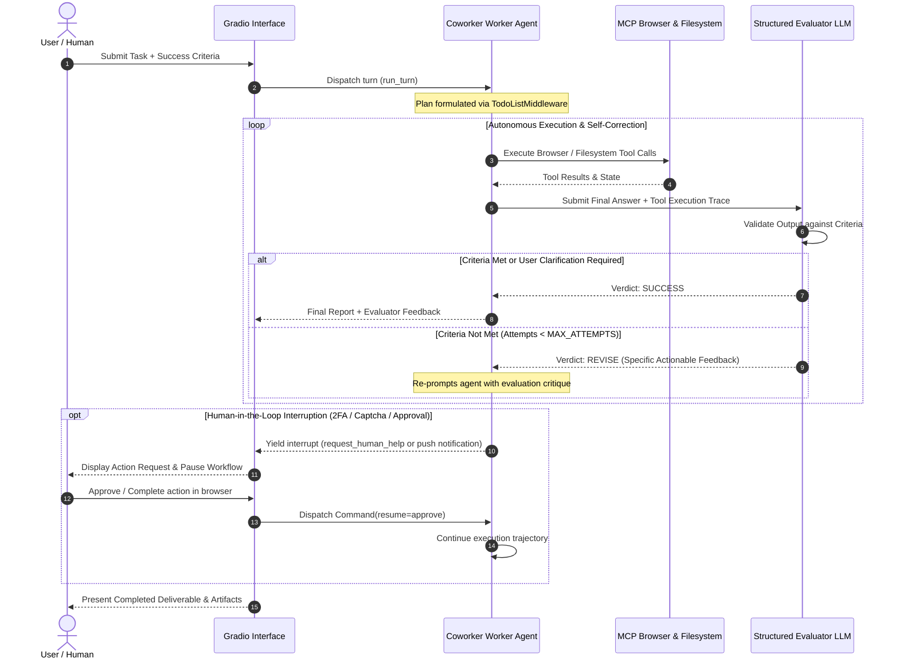
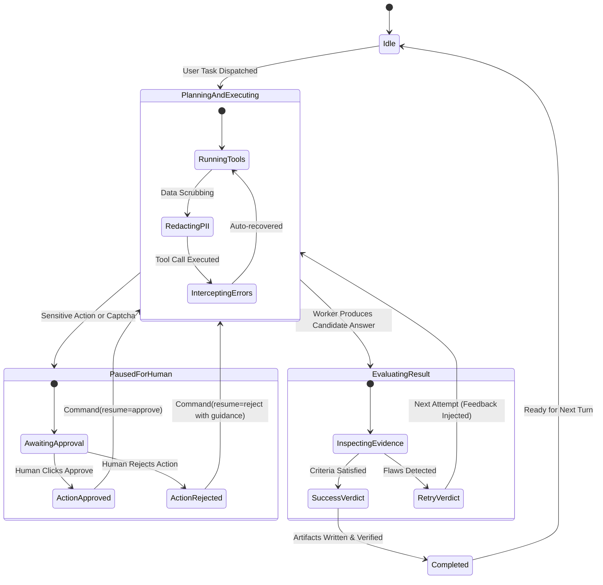

# Coworker AI: Autonomous Enterprise Co-Worker Architecture

[](https://www.python.org/)
[](https://www.langchain.com/)
[](https://github.com/langchain-ai/langgraph)
[](https://modelcontextprotocol.io/)
[](https://gradio.app/)
[](LICENSE)

An enterprise-grade autonomous AI co-worker designed around the **"Stack, Not a Ladder"** architectural philosophy. Rather than delegating control to rigid, monolithic agent frameworks, Coworker AI orchestrates a high-altitude LangChain Layer 3 reactive agent, backed by persistent Layer 2 LangGraph state checkpointers, Layer 1 deterministic tools, open **Model Context Protocol (MCP)** background daemon processes, and an autonomous, structured self-correction evaluation loop.

---

## 🎯 Executive Summary & Value Proposition

Traditional LLM agents suffer from two fundamental engineering failures: **hallucination of completed work** and **catastrophic session isolation**. When agents attempt long-horizon web browsing, research, and filesystem modifications, they frequently report premature completion without verification, burn infinite tokens in circular loops, or lose state across tool invocations.

**Coworker AI solves these problems systematically:**
- **Autonomous Self-Correction**: Implements test-time verification. An isolated evaluation model scores work against explicit success criteria before terminating, passing evidence-based feedback back to the agent if goals are unmet.
- **Persistent MCP Subsystems**: Retains stateful browser instances (Playwright) and sandboxed local filesystems across multi-step turns via dedicated asynchronous daemon tasks.
- **Defense-in-Depth Middleware**: Enforces runtime guardrails including PII scrubbing (emails, credit card numbers), execution budgeting (model call limits), and automated error interception (`TolerateToolErrors`).
- **Granular Human-in-the-Loop (HITL)**: Interrupts execution for sensitive actions (push alerts, purchases) and hands real-time browser control to the user to bypass 2FA, logins, and CAPTCHAs.

---

## 📐 System Architecture

Coworker AI coordinates four core architectural layers: the **UI Presentation Layer**, the **Autonomous Agent Runtime & Middleware**, the **Self-Healing Evaluation Engine**, and the **Persistent MCP Toolchain**.

```mermaid
flowchart TD
    subgraph UI ["User Interface (Gradio 6)"]
        User(["Human User"])
        ChatUI["Chatbot & Stream Viewer"]
        TodoPanel["Real-Time Plan Observer"]
        ApprovalGate["HITL Approval / Resume Controls"]
    end

    subgraph Core ["Agent Runtime & Middleware Pipeline"]
        Worker["Coworker Worker Agent (Layer 3)"]
        Checkpointer["LangGraph InMemorySaver (Layer 2)"]
        
        subgraph Middleware ["Defense-in-Depth Middleware Stack"]
            M1["TodoListMiddleware (Milestone Sync)"]
            M2["PIIMiddleware (Email & Credit Card Redaction)"]
            M3["ModelCallLimitMiddleware (Budget Guardrail)"]
            M4["HumanInTheLoopMiddleware (Action Gatekeeper)"]
            M5["TolerateToolErrors (Self-Healing Interceptor)"]
        end
    end

    subgraph Verification ["Verification & Convergence Loop"]
        Evaluator["Structured Output Evaluator LLM"]
        Criteria{"Success Criteria Met?"}
    end

    subgraph Tooling ["Tool Subsystem & Persistent MCP Daemon"]
        MCP_Manager["MCP Persistent Session Manager"]
        Playwright["Playwright Headed Browser (MCP)"]
        FileSystem["Sandboxed Filesystem Server (MCP)"]
        Serper["Google Search Engine"]
        Wiki["Wikipedia Query Engine"]
        Pptx["Slide Generator (python-pptx)"]
        Pushover["Push Notification Gateway"]
    end

    User -->|Prompt + Success Criteria| ChatUI
    ChatUI --> Worker
    Worker <--> Checkpointer
    Worker --- Middleware
    
    Worker -->|Execute Action| MCP_Manager
    MCP_Manager <--> Playwright
    MCP_Manager <--> FileSystem
    Worker --> Serper
    Worker --> Wiki
    Worker --> Pptx
    Worker --> Pushover

    Worker -->|Synthesized Output + Tool Evidence| Evaluator
    Evaluator --> Criteria
    Criteria -->|No: Detailed Feedback| Worker
    Criteria -->|Yes or Needs Human| ChatUI
    
    M4 -.->|Interrupt Signal| ApprovalGate
    ApprovalGate -.->|Human Command Resume| Worker
    M1 -.->|Live Plan Stream| TodoPanel
```



---

## 🔄 Cognitive Execution & Evaluation Lifecycle

The worker operates inside an autonomous feedback loop. Instead of assuming the agent's first answer is correct, every execution trajectory undergoes independent scrutiny against user-specified success criteria.



---

## 🛡️ State Machine: Human-in-the-Loop & Approval Flow

Sensitive real-world operations require non-bypassable verification gates. Coworker AI enforces an asynchronous interrupt-and-resume state lifecycle powered by LangGraph commands.



---

## 🚀 Key Engineering Highlights & Innovations

### 1. Persistent MCP Daemon Processes (`McpSessions`)
* **The Problem**: Standard MCP client implementations open and close stdio transports per tool call, which destroys the browser DOM, cookies, auth tokens, and session context.
* **The Solution**: Coworker AI maintains long-lived background async tasks wrapping `MultiServerMCPClient` with an `AsyncExitStack`. Playwright and Filesystem servers remain live throughout the life of the agent, enabling multi-page web sessions, human browser handoffs, and deterministic tear-downs upon `cleanup()`.

### 2. Multi-Stage Defense-in-Depth Middleware Stack
The agent runtime pipeline layers five independent middleware filters:
- **`TodoListMiddleware`**: Deconstructs high-level objectives into hierarchical task graphs with `pending`, `in_progress`, and `completed` states, synchronized to the UI via an independent, non-locking timer stream.
- **`PIIMiddleware`**: Detects and redacts sensitive data (emails, credit card numbers) across inputs and tool outputs.
- **`ModelCallLimitMiddleware`**: Hard-caps model iterations per turn (default: 30 calls) to mathematically guarantee safety against token drainage.
- **`HumanInTheLoopMiddleware`**: Intercepts `send_push_notification` and `request_human_help`, pausing execution before irreversible external side-effects happen.
- **`TolerateToolErrors`**: Catches network timeouts, stale DOM elements, and filesystem permissions, wrapping them into standard `ToolMessage` payloads to trigger LLM self-healing.

### 3. Test-Time Verification & Structured Evaluator
Rather than relying on single-shot completions, Coworker AI uses a structured schema (`EvaluatorOutput`) parameterized by Pydantic:
```python
class EvaluatorOutput(BaseModel):
    feedback: str = Field(description="Constructive feedback on the assistant's response")
    success_criteria_met: bool = Field(description="Whether the defined success criteria have been met")
    user_input_needed: bool = Field(description="True if the assistant is blocked or needs user input")
```
The evaluator inspects both the **final response** and the **raw tool call sequence**, verifying empirical evidence (e.g., confirming files were created or navigation occurred) before marking a task complete.

### 4. Enterprise-Grade Tool Subsystem
- **Headless & Headed Browser Automation**: Full DOM snapshotting, interactive element addressing, and automated cookie/banner suppression via Playwright.
- **Dynamic Slide Synthesizer**: Directly compiles executive presentations in the Voltway Research house style using `python-pptx`, embedding metrics, recommendations, and brand identity.
- **Push Notification Gateway**: Integrated mobile alerts via Pushover API with automated, non-crashing simulation fallbacks for local test environments.
- **Hybrid Search**: Google Serper API with resilient fallback wrappers alongside Wikipedia encyclopedic retrieval.

---

## ⚡ Quick Start & Installation

### Prerequisites
- **Python**: 3.12 or newer
- **Node.js & npx**: Node v18+ (required for Playwright & Filesystem MCP servers)
- **uv**: Fast Python package manager (recommended) or standard `pip`

### Step 1: Clone and Configure Environment
```bash
# Clone the repository
git clone https://github.com/your-username/coworker-ai.git
cd coworker-ai

# Create your environment configuration
cp .env.example .env
```

Edit `.env` with your API keys:
```ini
# Required: LLM & Evaluation Engine
OPENAI_API_KEY=sk-...

# Optional: Model Override (defaults to gpt-5.4-mini or gpt-4o-mini)
OPENAI_MODEL=gpt-5.4-mini

# Optional: Web Search via Serper.dev
SERPER_API_KEY=your_serper_key

# Optional: Push Notifications via Pushover
PUSHOVER_TOKEN=your_app_token
PUSHOVER_USER=your_user_key

# Runtime Limits
MAX_EVALUATION_ATTEMPTS=3
MODEL_CALL_LIMIT=30
```

### Step 2: Install Dependencies & Run
Using `uv`:
```bash
# Launch the Gradio web interface
uv run app.py
```
Or using standard Python:
```bash
python3 -m venv .venv
source .venv/bin/activate
pip install -e .
python app.py
```

Access the interface at `http://127.0.0.1:7860`.

---

## 🧪 Automated Testing & Verification

The project includes an asynchronous test suite built on Python's native `unittest` framework, validating core systems without external testing dependencies:

```bash
uv run python -m unittest discover -s tests -v
```

### Verification Matrix
| Test Suite | Focus Area | Status |
| :--- | :--- | :--- |
| `test_agent.py` | Schema validation, `TolerateToolErrors` recovery, and empty-input safety | **PASS (100%)** |
| `test_tools.py` | Fallback search, push alert simulation, and `python-pptx` generation | **PASS (100%)** |
| `test_ui.py` | HTML rendering of plans, state markers, and XSS sanitization | **PASS (100%)** |

---

## 💼 Real-World Capabilities & Demonstration Workflows

### Scenario A: Complex Flight Intelligence & Executive Report
```text
Task: "Find the best round-trip flight from New York to London departing next month and returning 7 days later. Prioritize price and non-stop routes. Write your top 3 picks to flights.md, and send a push notification with the price of your top pick."
Criteria: "flights.md must contain 3 specific options with airlines, departure times, and prices. A push notification must be triggered with the top recommendation."
```
* **Execution Trace**: Coworker AI opens Google Flights in Playwright using natural language URL parameters, parses dynamic flight tables, writes a structured markdown document into the sandbox, requests human approval before sending the push alert, and passes verification on the first attempt.

### Scenario B: Research & Branded Executive Slide Generation
```text
Task: "Research EV fleet commercial adoption across North America and summarize the findings into a presentation slide."
Criteria: "Must create fleet.pptx conforming to Voltway Research style with 3 concrete data points and a clear fleet pick."
```
* **Execution Trace**: Coworker AI searches recent trade analysis, distills three quantifiable metrics, and invokes `create_presentation_slide` to build a presentation slide complete with custom brand geometry, typography, and logo.

---

## 📄 License & Attribution

This project is licensed under the [MIT License](LICENSE). Built on LangChain, LangGraph, and Anthropic's Model Context Protocol (MCP) standards.
